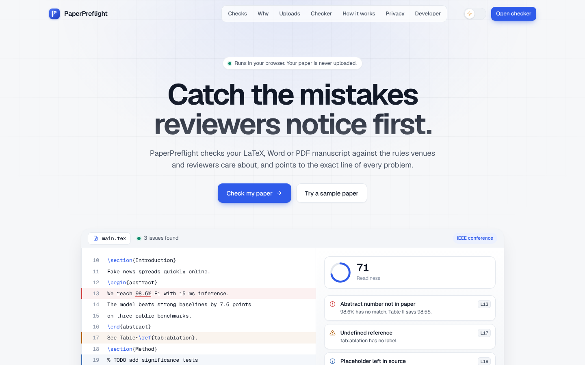
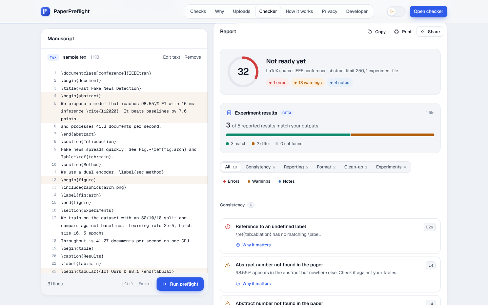
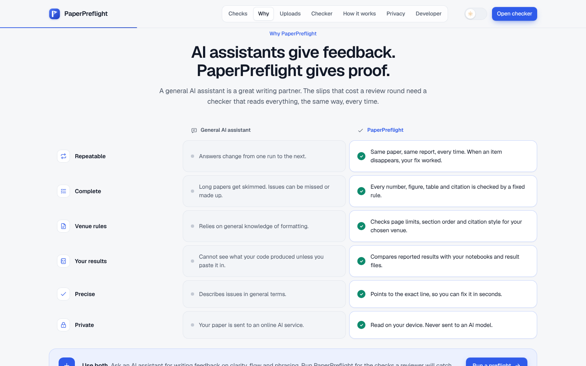
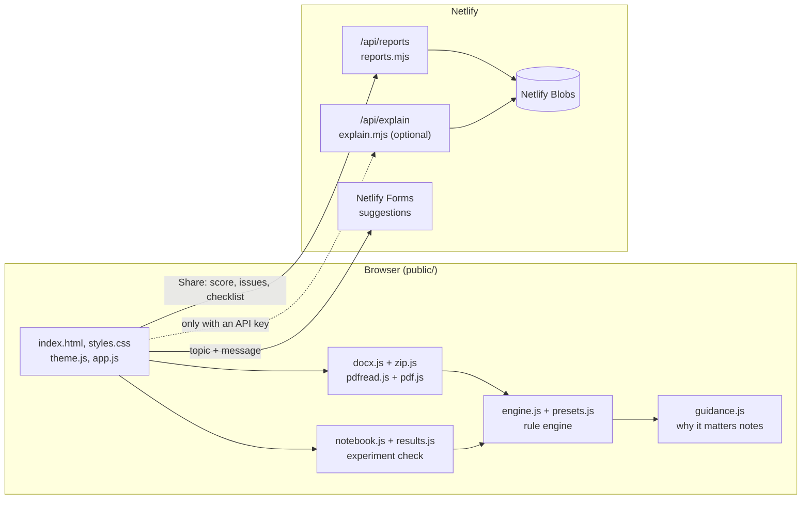

<div align="center">

<picture>
  <source media="(prefers-color-scheme: dark)" srcset="docs/assets/logo-dark.svg">
  
</picture>

<p><b>A pre-submission checker for research papers.</b><br>
Upload your LaTeX, Word or PDF manuscript and get a line-by-line report of the slips reviewers notice first,<br>
in seconds, on your own device.</p>


<p>
<a href="#why-paperpreflight">Why</a> &nbsp;&middot;&nbsp;
<a href="#what-it-checks">What it checks</a> &nbsp;&middot;&nbsp;
<a href="#quick-start">Quick start</a> &nbsp;&middot;&nbsp;
<a href="#what-each-upload-does">Uploads</a> &nbsp;&middot;&nbsp;
<a href="#for-developers">For developers</a> &nbsp;&middot;&nbsp;
<a href="#credits">Credits</a>
</p>

<br>

<picture>
  <source media="(prefers-color-scheme: dark)" srcset="docs/assets/demo-dark.svg">
  
</picture>

</div>

<br>

##  What is PaperPreflight?

PaperPreflight reads your manuscript the way a careful reviewer would on a first pass. It checks the numbers in your abstract against your tables, every figure, table and citation reference, your reporting checklist, your venue's format rules, and, for AI and ML papers, whether the results you report match what your experiments actually produced.

Every issue comes with the exact line it is on, a severity, and a short note on why it matters and how to fix it. You get a readiness score out of 100 and can share the list of issues with a co-author through a private link.

> [!NOTE]
> Your paper never leaves your device. Files are opened inside your browser, and nothing is uploaded to us or to any AI service.

<br>

##  Why PaperPreflight?

General AI assistants are great writing partners. The slips that cost a review round need something different: a checker that reads everything, the same way, every time.

| | General AI assistant | PaperPreflight |
|---|---|---|
|  **Repeatable** | Answers change from one run to the next. | Same paper, same report, every time. When an issue disappears, your fix worked. |
|  **Complete** | Long papers get skimmed. Issues can be missed or made up. | Every number, figure, table and citation is checked by a fixed rule. |
|  **Venue rules** | Relies on general knowledge of formatting. | Checks page limits, section order and citation style for your chosen venue. |
|  **Your results** | Cannot see what your code produced unless you paste it in. | Compares reported results with your notebooks and result files. |
|  **Precise** | Describes issues in general terms. | Points to the exact line, so you can fix it in seconds. |
|  **Private** | Your paper is sent to an online AI service. | Read on your device. Never sent to an AI model. |

**Use both.** Ask an AI assistant for writing feedback on clarity, flow and phrasing. Run PaperPreflight for the checks a reviewer will catch.

<br>

##  What it checks

| | Category | What gets flagged |
|---|---|---|
|  | **Consistency** | Numbers in the abstract that never appear in the paper, only match after rounding (98.6 against 98.55), or appear in no table. Figures and tables mentioned but never captioned, or captioned but never mentioned. Undefined LaTeX labels. Citations with no bibliography entry, and entries nobody cites. |
|  | **Reporting** | A checklist for machine learning papers: dataset, data split, seeds or repeated runs, baselines, hyperparameters, significance tests, ablation, limitations, leakage safeguards, code and data availability. |
|  | **Format** | Abstract word limit, page limit, expected and required sections and their order, citation style, document class, venue style package, bibliography style, keywords, layout overrides, fonts in Word files, and an optional comparison with the venue's template. |
|  | **Clean-up** | Leftovers that should never reach an editor: TODO and placeholder markers, highlighted text, unresolved tracked changes and comments. |
|  | **Experiments** <sub>beta</sub> | Results reported in the paper compared with the saved outputs of your Jupyter notebooks, result CSV files or a zip of results. Also flags notebooks with errors, cells run out of order, or no saved outputs. |

Each issue is an **error**, a **warning** or a **note**. The readiness score is 100 minus 12 per error, 4 per warning and 1 per note.

<br>

##  Quick start

1. **Open the site** and scroll to **Run a preflight**, or click **Try a sample paper** to see a full report first.
2. **Pick your venue** (IEEE, ACM, NeurIPS, ICML, ACL, Springer LNCS, Elsevier or none). The abstract and page limits fill in for you, and you can edit them.
3. **Add your manuscript.** Drop a `.tex`, `.docx` or `.pdf` file, or paste text.
4. **Read the report.** Click a line number such as `L13` to jump to it, open **Why it matters** under any issue for a plain-language fix, and use **Share** to send the list of issues to a co-author. Shared links expire after 30 days.

> [!TIP]
> Fix a few issues and run the check again. Because the rules never change between runs, a disappearing issue means your fix worked.

<br>

##  What each upload does

Only the manuscript is required. Each extra file switches on more checks, and none of them leave your device.

| | Upload | What it does |
|---|---|---|
|  | **Manuscript** <sub>required</sub> | Your paper as LaTeX, Word or PDF. Every check reads it, and each issue points to the exact line. |
|  | **Venue template** <sub>optional</sub> | The official `.docx` or `.tex` template from the conference or journal. Your layout, fonts and sections are compared with it. |
|  | **Bibliography** <sub>optional</sub> | Your `.bib` file. Every citation is matched with an entry, and entries you never cite are pointed out. |
|  | **Notebooks** <sub>optional, beta</sub> | Jupyter notebooks saved with their outputs. Results in your paper are compared with what your code printed. |
|  | **Results zip** <sub>optional, beta</sub> | No notebook outputs? Upload the output zip of a Kaggle saved version, or zip your results folder yourself. CSV and text files inside are checked the same way. Plots are listed so you can check them by eye. |

<br>

##  A look inside

<table>
<tr>
<td width="50%"><picture><source media="(prefers-color-scheme: dark)" srcset="docs/screens/hero-dark.png"></picture><p align="center"><sub>Home page, with a live demo of the check</sub></p></td>
<td width="50%"><picture><source media="(prefers-color-scheme: dark)" srcset="docs/screens/report-dark.png"></picture><p align="center"><sub>A report: flagged lines, score and experiment summary</sub></p></td>
</tr>
<tr>
<td colspan="2"><picture><source media="(prefers-color-scheme: dark)" srcset="docs/screens/why-dark.png"></picture><p align="center"><sub>Light and dark themes are designed separately. Your system setting picks one, and a switch in the header flips it.</sub></p></td>
</tr>
</table>

<br>

##  Privacy in one paragraph

Your manuscript, template, bibliography and experiment files are read by your browser and never uploaded. Nothing is executed. **Share** stores only the score, the list of issues and the checklist, never the paper, and issues that would quote your text (such as a leftover TODO line) are replaced with a neutral note before saving. Shared reports are deleted 30 days after the link is created. The suggestion box sends only a topic and your message, with no name or email.

<br>

---

<br>

##  For developers

Everything below is for people who run, change or deploy PaperPreflight.

### Architecture



| Path | Role |
|---|---|
| `public/engine.js`, `public/presets.js` | Rule engine and venue presets. Deterministic, no network. |
| `public/guidance.js` | A prewritten "why it matters and how to fix it" note for every rule. |
| `public/notebook.js`, `public/results.js` | Experiment check (beta): notebook parsing, CSV and results zips, result matching. |
| `public/docx.js`, `public/zip.js` | Word reader with a streaming, size-capped zip inflater. |
| `public/pdfread.js`, `public/vendor/pdfjs/` | PDF reader, lazy loaded only when a PDF is chosen. |
| `netlify/functions/reports.mjs` | Saves and serves shared reports in Netlify Blobs. |
| `netlify/functions/explain.mjs` | Optional longer explanations. Hidden unless an API key is set. |
| `netlify/lib/` | Shared validation for the functions, unit tested. |
| `test/` | Tests and fixture generators. |
| `docs/` | README artwork and screenshots. `docs/make_assets.py` rebuilds the artwork. |

**Storage.** Netlify Blobs, one JSON document per shared report under an 80-bit random id. No connection strings and no SQL surface. If accounts and report history are added later, move to Netlify DB (Postgres) behind the same endpoint shape.

**Explanations.** `public/guidance.js` holds a fixed note for every rule. It is shown under each finding with the **Why it matters** button, works offline, costs nothing and never changes between runs. `test/guidance.test.mjs` fails if any rule is missing a note.

<details>
<summary><b>Optional detailed explanations (off by default)</b></summary>
<br>

If `ANTHROPIC_API_KEY` is set, a **More detail** link appears inside the note and calls `/api/explain` for a longer, tailored explanation. The site does not name the provider, and without the key nothing about it is shown. The rule engine still decides every finding and the score. The function sends only the finding title and detail, the venue and the input format; the flagged line is sent only if the user ticks the option in the report. Explanations without an excerpt are cached in Blobs for 30 days, so common findings cost one call in total. Optional settings: `CLAUDE_MODEL` (default `claude-opus-5-5`) and `EXPLAIN_DAILY_LIMIT` (default 300).

</details>

### Run and test locally

```bash
npm install
npm test               # engine, Word, PDF, functions, experiment check and guidance tests
npx netlify dev        # local site with functions and Blobs
```

Requires Node 20 or later. Fixtures are generated by `test/make_fixtures.py` (Word), `test/make_pdf_fixture.py` (PDF, needs reportlab) and `test/make_results_zip.py` (results zip). After upgrading pdf.js or a font package, run `npm run vendor` to copy the files into `public/`.

### Deploy on Netlify

1. Push this folder to a GitHub repository.
2. In Netlify: **Add new site**, **Import an existing project**, pick the repository. Leave the build command empty. The publish directory (`public`) and functions directory (`netlify/functions`) are already set in `netlify.toml`.
3. Deploy. Blobs needs no setup and no API key is needed.
4. Optional: to switch on **More detail** explanations, add `ANTHROPIC_API_KEY` under **Site configuration, Environment variables** (mark it secret and scope it to Functions).

### Set up the suggestion box

The **Suggest an improvement** form is a Netlify Form named `suggestions`. The address that receives suggestions lives in the Netlify dashboard, not in the code. One-time setup after the first deploy:

1. Netlify dashboard, your site, **Forms**. If form detection is off, click **Enable form detection**, then trigger a new deploy (**Deploys, Trigger deploy**) so Netlify finds the form.
2. **Forms, Form notifications, Add notification, Email notification.** Event: new form submission. Form: `suggestions`. Email to notify: `maisha.mahfuza13@gmail.com`. Save.
3. Send a test suggestion from the live site and check that the email arrives. Look in spam the first time and mark it as not spam.

Submissions are also listed under **Forms**. The free plan includes 100 form submissions a month. Spam protection: a hidden honeypot field (`company`, declared with `netlify-honeypot`), a client-side check that drops submissions made within three seconds of loading, a 2,000 character cap, and Netlify's built-in spam filter. The form is sent with `fetch`, so the strict CSP (`form-action 'none'`) stays in place. Netlify keeps its own request metadata for submissions, so the page promises that no name, email or paper is sent rather than that nothing at all is recorded.

### Security model

- **Manuscripts stay in the browser.** Files are parsed client side. The share endpoint accepts only an allow-listed report shape, and findings that quote manuscript text have their detail replaced on both client and server.
- **Upload handling.** Extension and magic-byte checks (`PK` for .docx and .zip, `%PDF-` for PDF). Size caps: 25 MB documents, 5 MB text and .bib, 30 MB notebooks, 20 MB result files, 150 MB results zips, at most five experiment files per check. The zip reader counts bytes while inflating, so a zip bomb cannot expand without bound. PDFs are capped at 300 pages, and pdf.js runs with `isEvalSupported: false`. Nothing uploaded is ever executed.
- **Endpoints.** Same-origin check, `application/json` required, body caps (60 KB reports, 4 KB explain), strict field truncation, ids validated with `^[a-f0-9]{20}$`, Netlify rate limits (20 per minute per IP for reports, 10 for explain), a soft daily cap on explanations, and `no-store` plus `noindex` on every API response.
- **Expiry.** Shared reports expire after 30 days, checked and deleted on read.
- **Browser hardening** (`netlify.toml`). A CSP with no third-party origins at all (fonts and pdf.js are self-hosted), no inline scripts or styles, `object-src 'none'`, `frame-ancestors 'none'`, COOP and CORP same-origin, HSTS, nosniff, no referrer, and a locked-down Permissions-Policy.
- **XSS.** Every user-derived string is rendered with text nodes. `innerHTML` is used only for the static icon set.
- **Secrets.** The only secret is the optional `ANTHROPIC_API_KEY`, kept in Netlify environment variables and never in the repository.

<details>
<summary><b>How the experiment check works (beta)</b></summary>
<br>

The **Experiment results** upload takes up to five items per check, in any mix:

- Jupyter notebooks (`.ipynb`, 30 MB each) saved with outputs.
- Result files (`.csv`, `.tsv`, `.txt`, `.json`, 20 MB each).
- A `.zip` of results (150 MB), such as the output zip of a Kaggle saved version or any zipped results folder. Notebooks and CSV or text files inside are read. Images and plots are listed in one note. Model weights and other binaries are skipped without being decompressed. Limits: at most 200 files read, 20 MB inflated per file and 60 MB per zip, counted while inflating. `__MACOSX` and checkpoint folders are ignored.

Steps:

1. **Outputs.** Every code cell's saved output is read: stdout and stderr streams, `text/plain` results, and HTML tables (tags stripped) when there is no plain text version. Each CSV row or text line is treated like a cell. Every number is collected with its file and cell, row or line.
2. **Reported results.** Decimals and percentages are taken from table rows, the abstract, and sentences that name a metric or result (accuracy, F1, BLEU, loss, AUC, gain, throughput and similar). Integers, years and version numbers are left out. Word marks table cells; in PDF and plain text, a short row with three or more numbers counts as a table row.
3. **Matching.** A paper value matches when an output equals it, rounds to it at the paper's precision, or does so after converting between a fraction and a percentage (0.98547 matches 98.55%). Lookups use a sorted index, so large result files stay fast.
4. **Findings.** A value within 3% of an output that does not round to it is a warning, **Result differs from your outputs**, flagged on the paper line with the closest output and where it is, for example "row 2 of metrics.csv". A value with no close output is a note, **Result not found in your outputs**, since numbers quoted from other papers are expected. Notebooks with no saved outputs, error outputs, cells run out of order, or code cells that never ran get their own findings.

The report shows a summary such as "3 of 5 reported results match your outputs", with match, differ and not-found counts. A shared report keeps only those counts, never file names or values.

</details>

<details>
<summary><b>Formats and venue presets</b></summary>
<br>

- **LaTeX** (`.tex` upload or paste). Locations are source lines, such as `L12`.
- **Word** (`.docx`). Read with a built-in zip and XML reader. Locations are paragraph numbers, such as `P12`. Word-only checks: tracked changes, comments, highlights, fonts, images against captions, and template layout comparison.
- **PDF.** Read with pdf.js. Text is rebuilt into paragraphs with page and line numbers, such as `p3 l12`. The page limit uses the real page count. For venues where references do not count, the main text ends on the page where the References heading appears. Scanned PDFs without a text layer cannot be checked.
- **Plain text** pasted from anywhere, with the same checks as Word minus the Word-only ones.

`public/presets.js` holds presets for IEEE conferences, ACM (acmart), NeurIPS, ICML, ACL long and short papers, Springer LNCS and Elsevier journals. A preset fills in the abstract and page limits (both editable) and switches on its rules: expected class or style package, bibliography style, citation style and required sections (for example the Limitations section for ACL, the checklist for NeurIPS and the impact statement for ICML). These are typical values from recent calls for papers. Check them each cycle, since venues change limits from year to year.

</details>

<details>
<summary><b>Design system</b></summary>
<br>

- **Two palettes, designed separately.** Daylight: paper white `#F6F7F9`, white surfaces, slate ink `#111827`, cobalt accent `#2F5BEA`. Midnight: deep navy `#0A0F1C`, lifted surfaces `#111A2D` and `#16213A`, periwinkle accent `#7C9CFF`, mint, amber and coral severities, soft glows. Never pure black or pure white.
- **Logo.** A P monogram whose bowl is a folded paper plane, on a cobalt gradient tile (`#4C74F5` to `#2140C4`) that stays the same in both themes.
- **Type.** Geist for text and Geist Mono for source and locations, self-hosted.
- **Rhythm.** 4px base, 112 to 128px between sections, 28px card padding, radii of 10, 14 and 20px.
- **Navigation.** A sticky bar with a section menu that highlights the section in view, a scroll progress line, the theme switch and **Open checker**. Below 1200px it becomes a **Menu** panel listing every section.
- **Motion.** The hero window scans the sample and settles the score on a loop while visible, sections fade up on scroll, the score ring fills and findings stagger in. Everything is off under `prefers-reduced-motion`.
- **Copy rules.** One icon family at 1.6px stroke. No emojis and no em dashes anywhere.
- **Accessibility.** Visible focus rings, a skip link, an aria-live report, pressed and selected states on toggles, Ctrl or Cmd plus Enter to run, and a print stylesheet that prints the report only.

</details>

### Known limits

- Word does not store a reliable page count, and LaTeX source has none. Upload the compiled PDF to check the page limit.
- PDF paragraph rebuilding works well for one and two column layouts. Unusual layouts can merge or split paragraphs. Figure and table detection depends on caption text such as "Figure 3" or "TABLE II".
- Numbered citations are cross-checked with the reference list. Author-year citations are counted for style checks but not matched entry by entry.
- The experiment check compares numbers, not their meaning. Two unrelated values that round the same way count as a match. Attach final results rather than full training logs, since logs with many numbers make chance matches more likely.
- PDFs that use CJK fonts without embedded character maps may extract poorly.

### Roadmap

Per-rule ignore toggles, a venue preset editor, author-year matching against `.bib` entries, and an optional account with report history on Netlify DB.

<br>

---

<br>

##  Credits

<table>
<tr>
<td>

**Mahfuza Maisha**<br>
<sub>Researcher and Research Mentor &middot; Creator of PaperPreflight</sub>

Starts from a real problem and follows it into whatever field the solution needs. Has guided 15+ student teams to submission.

<a href="https://mahfuza-maisha-portfolio.netlify.app/">Portfolio</a> &nbsp;&middot;&nbsp;
<a href="https://github.com/C221213-Maisha">GitHub</a> &nbsp;&middot;&nbsp;
<a href="https://linkedin.com/in/mahfuza-maisha">LinkedIn</a> &nbsp;&middot;&nbsp;
<a href="https://scholar.google.com/citations?user=zTnZHBQAAAAJ&amp;hl=en">Google Scholar</a> &nbsp;&middot;&nbsp;
<a href="https://orcid.org/0009-0001-7309-5771">ORCID</a>

</td>
</tr>
</table>

Have an idea for a new check or venue? Use **Suggest an improvement** at the end of the site. It is anonymous.

<div align="center">
<br>
 <sub>PaperPreflight is a guide, not a verdict. Always confirm limits in your venue's call for papers.</sub>
</div>
